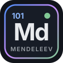

<div align="center">



# Mendeleev

**Element 101 `Md (Mendelevium)`** — Inspect every Antigravity model call like a chemist: exact context breakdown, cache hit rate, generation speed, TTFT, estimated cost, and quota pools in one minimal side panel.

[](LICENSE)
[](#)

English · [简体中文](README.zh-CN.md)

</div>

---

## Why Mendeleev?

There are already great monitoring plugins in the Antigravity ecosystem:
- **[antigravity-desktop-context](https://github.com/dimitr-io/antigravity-desktop-context)** delivers a clean, native-feeling sidebar UX and an intuitive 100-dot context grid.
- **[antigravity-usage-monitor](https://github.com/yuhuan-dev/antigravity-usage-monitor)** provides rich telemetry (cache hit rate, request-level TPS, native TTFT, cost estimation, and quota pools).

**Mendeleev** is written from scratch in pure Node.js (zero Python, zero external npm dependencies) to combine that minimal sidebar UX with essential performance & cost telemetry, plus bilingual (`中 / EN`) switching and collapsible sections.

## Features

- **100-Dot Context Grid & Breakdown**: Reads exact `tokenBreakdown` directly from Antigravity Language Server (`GetCascadeTrajectory` & `GetAvailableModels`), visualizing system prompt, user messages, agent responses, tool calls, and customizations.
- **2×2 Telemetry Micro-Cards**:
  - **Cache Hit Rate**: Tracks cache-read ratio (`cacheRead / (input + cacheRead)`) and uncached input tokens.
  - **Output Speed**: Computes session average and latest step decode speed (`tok/s`) from `streamingDuration` (filtering out short buffered tool-call bursts).
  - **TTFT**: Reads native `timeToFirstToken` (session average & latest).
  - **Estimated Cost (USD)**: Estimates session cost and cache savings using a built-in pricing catalog.
- **Quota Pools (`GetUserStatus`)**: Compact progress bars showing remaining quota and reset countdowns for the active model pool and other model families.
- **Collapsible Sections with Persistence**: Every section (`Token usage`, `Quota pools`, `Checkpoints`, `Knowledge / Artifact / Skill / System` files) is collapsible with item counts and persisted state (`Checkpoints` and `Skill files` are collapsed by default).
- **Bilingual UI (`中 / EN`)**: One-click language toggle in the header, persisted to `localStorage`.
- **Zero Dependencies**: Pure Node.js runtime—no Python version compatibility issues and no `npm install` required.

## Installation

Clone this repository into your Antigravity plugins directory:

```bash
# macOS / Linux
git clone https://github.com/Xav1erSue/antigravity-mendeleev.git ~/.gemini/config/plugins/mendeleev
```

```powershell
# Windows (PowerShell)
git clone https://github.com/Xav1erSue/antigravity-mendeleev.git "$env:USERPROFILE\.gemini\config\plugins\mendeleev"
```

Then enable **Mendeleev · 门捷列夫** in **Customizations → Installed** in Antigravity Desktop and open **Mendeleev** in the right side panel.

## Development & Testing

```bash
node --test tests/test_analyzer.mjs
```

## Acknowledgements

This project stands on the shoulders of the following open-source projects (both MIT licensed):

- **[dimitr-io/antigravity-desktop-context](https://github.com/dimitr-io/antigravity-desktop-context)** (MIT License)
  - Inspired the minimal native sidebar visual design, the 100-dot context grid, and the context category breakdown layout.
- **[yuhuan-dev/antigravity-usage-monitor](https://github.com/yuhuan-dev/antigravity-usage-monitor)** (MIT License)
  - Referenced for Language Server RPC telemetry extraction (`timeToFirstToken`, `streamingDuration`, `modelUsage`, `GetUserStatus` quota pools) and the model pricing/placeholder catalog.

## License

[MIT](LICENSE) © 2026 [Xav1erSue](https://github.com/Xav1erSue)
